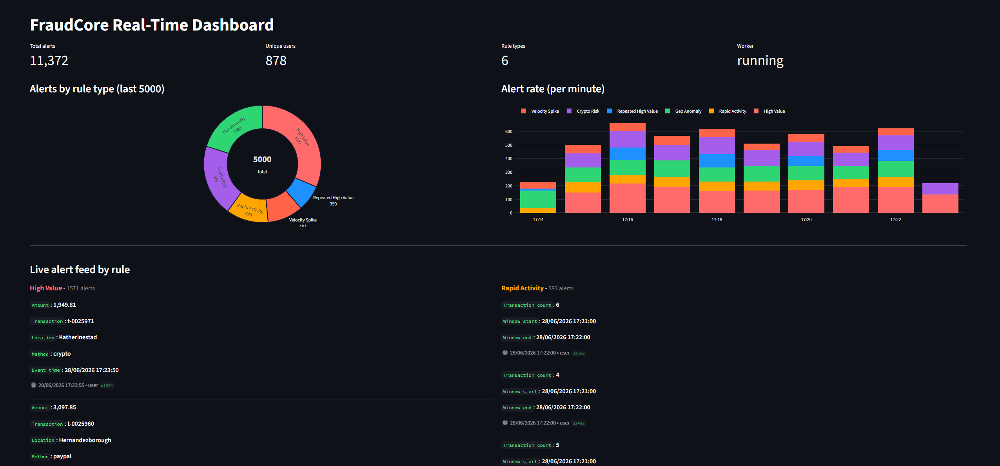
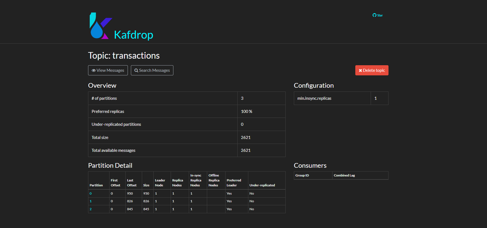
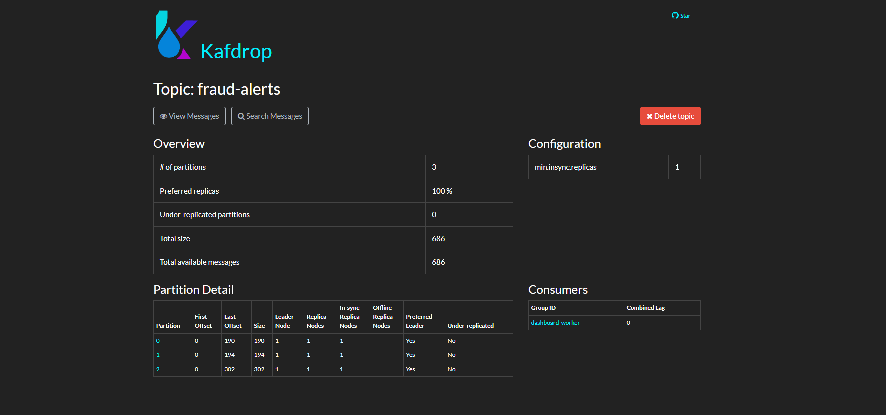
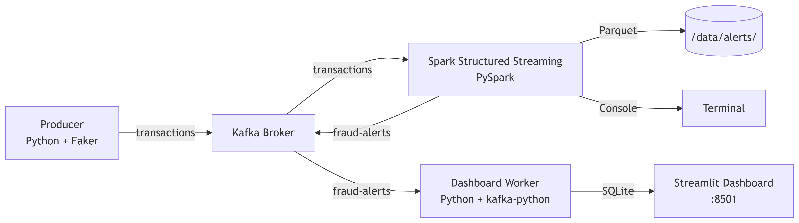

# FraudCore

Real-time fraud detection pipeline using Python, Kafka, Spark Structured Streaming, and Streamlit.

## Quick Start

### Prerequisites

- Docker & Docker Compose
- Python 3.10+

### 1. Start Infrastructure

```bash
docker compose up -d --build
```

This starts:
- **Kafka broker** on `localhost:9092`
- **Kafdrop** on [http://localhost:9000](http://localhost:9000)
- **Spark Streaming** reads `transactions`, writes alerts to Kafka + Parquet + console
- **Dashboard** (Streamlit + worker) on [http://localhost:8501](http://localhost:8501)

### 2. Start the Transaction Producer

```bash
cd producer
pip install kafka-python Faker
python producer.py
```

The producer sends 10–100 synthetic transactions per second to the `transactions` Kafka topic, with occasional fraud patterns injected.

### 3. Open the Dashboard and observe

Navigate to [http://localhost:8501](http://localhost:8501) to see real-time metrics, charts, and a live alert feed.


## Fraud Detection Rules

| # | Rule                  | Logic                                                       |
|---|-----------------------|-------------------------------------------------------------|
| 1 | HIGH_VALUE            | Single transaction amount > 1 000                           |
| 2 | RAPID_ACTIVITY        | Same user performs > 3 transactions within 1 minute         |
| 3 | GEO_ANOMALY           | Same user appears in > 1 location within 1 minute           |
| 4 | REPEATED_HIGH_VALUE   | Same user makes ≥ 3 transactions > 1 000 within 2 minutes   |
| 5 | CRYPTO_RISK           | Payment method = crypto AND amount > 500                    |
| 6 | VELOCITY_SPIKE        | Same user spends > 5 000 total within 1 minute              |

## Output & Screenshots

### Dashboard



Updates every 2 seconds with KPIs, donut chart, histogram, and a live alert feed across all 6 rules.

### Kafka Topics (Kafdrop)

| Transactions | Fraud Alerts |
|---|---|
|  |  |

### Sample Logs

- [`producer.log`](assets/producer.log) : Producer terminal output (tx sent, legit vs fraud stats)
- [`spark-streaming.log`](assets/spark-streaming.log) : Spark console sink output (alerts being detected)
- [`kafka-init-topics.log`](assets/kafka-init-topics.log) : Kafka topic initialization

## Architecture



## Project Structure

| Folder | Purpose |
|---|---|
| `producer/` | Python app that generates synthetic transactions and injects fraud patterns into Kafka |
| `spark-streaming/` | PySpark Structured Streaming pipeline reads transactions, runs 6 fraud detection rules, writes alerts to sinks |
| `dashboard/` | Streamlit dashboard + Kafka worker consumes fraud alerts, stores in SQLite, renders live UI |
| `kafka/` | Topic initialization script (auto-creates `transactions` and `fraud-alerts`) |
| `assets/` | Screenshots and images for documentation |
